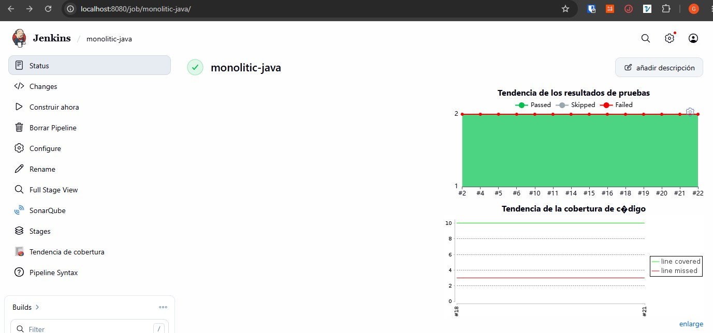
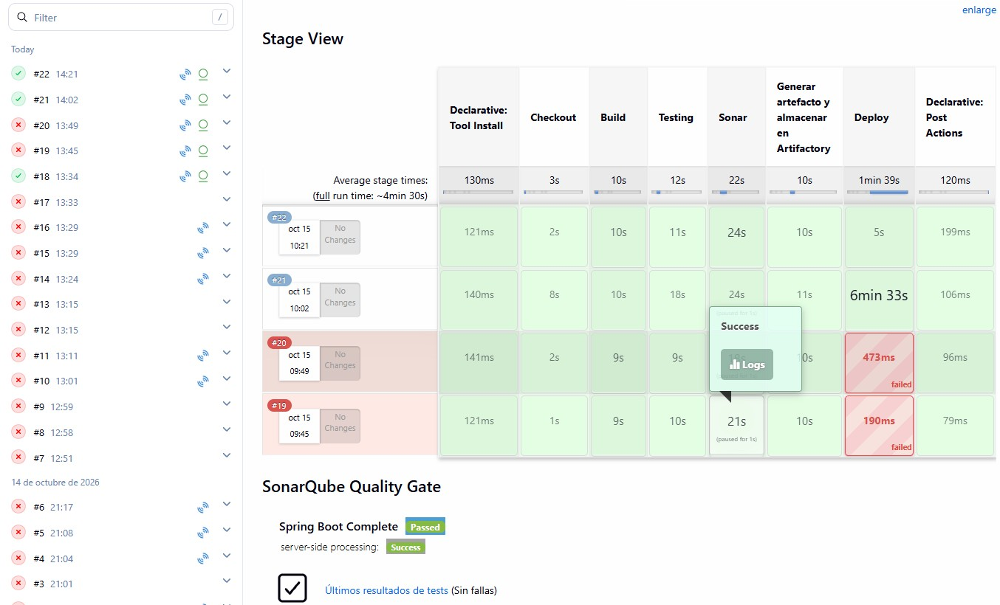
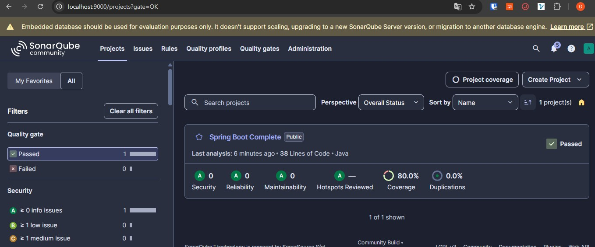
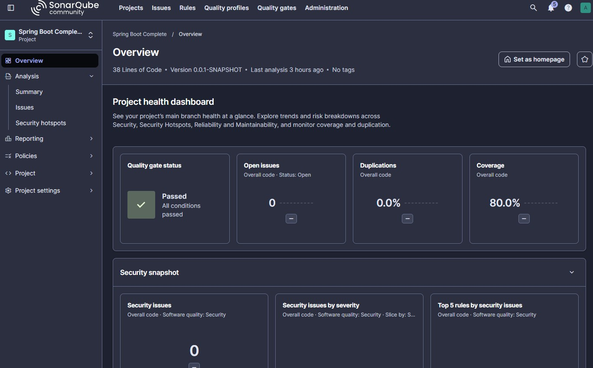
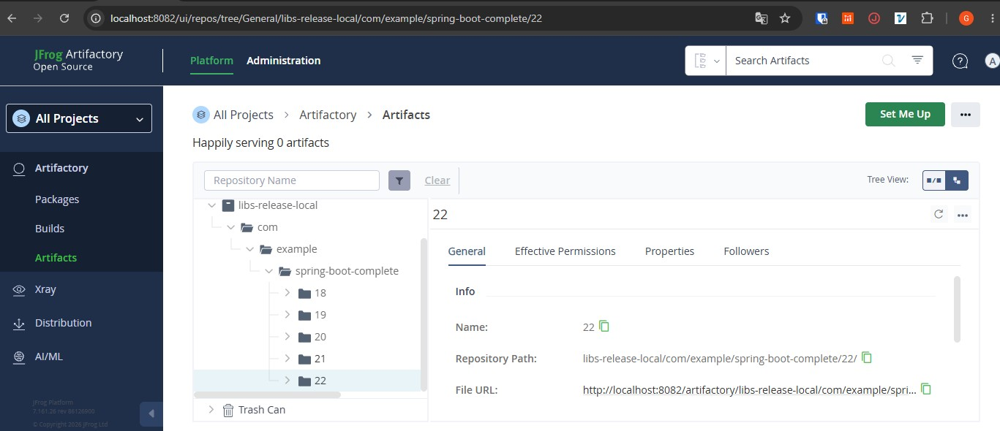
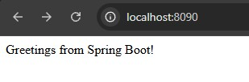
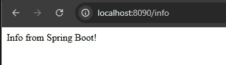

# Pipeline CI/CD — Tipo de Aplicación : Monolítica - Spring Boot

Pipeline de integración y entrega continua para una aplicación Spring Boot monolítica.

> 📖 Para la guía completa de configuración del entorno, ver [CONFIGURACION.md](CONFIGURACION.md)

---

## Herramientas configuradas en Jenkins

```groovy
 JDK: JDK-21
 Gradle: Gradle-8
```

## Variables de entorno

Credenciales en Jenkins Credentials Store

```groovy
environment {
    SONAR_PROJECT_KEY  = 'spring-boot-complete'
    SONAR_PROJECT_NAME = 'Spring Boot Complete'
    ARTIFACTORY_REPO   = 'libs-release-local'
    ARTIFACTORY_PASS = credentials('artifactory-credentials')
    GRADLE_USER_HOME = '/var/jenkins_home/.gradle'
}
```

## Flujo del pipeline

```
Checkout → Build → Testing → Sonar → Artifactory → Deploy
```





---

## Stage: Checkout

Limpia el workspace y clona el repositorio desde GitHub.

```groovy
stage('Checkout') {
    steps {
        // 1. Borrar todos los archivos ocultos y visibles del directorio actual
        deleteDir() 
        
        // 2. Ejecutar la clonación omitiendo el certificado SSL
        sh 'git -c http.sslVerify=false clone https://github.com/dozmaz/devsecops-monolitic-java.git .'
    }
}
```

---

## Stage: Build

Compila el proyecto con Gradle. Si falla, el pipeline se detiene.

```groovy
stage('Build') {
    steps {
        echo '=== STAGE: Build ==='
        // permisos de ejecución
        sh 'chmod +x ./gradlew'
        sh './gradlew clean assemble --no-daemon'
    }
    post {
        failure { error 'Build fallido. Revisa los errores de compilacion.' }
    }
}
```

**Salida:** clases compiladas en `build/classes/`

---

## Stage: Testing

Ejecuta los tests unitarios con JUnit y genera el reporte de cobertura con JaCoCo.  
Cobertura mínima requerida: **60%**

```groovy
stage('Testing') {
    steps {
        echo '=== STAGE: Testing (JUnit + JaCoCo) ==='
        sh './gradlew test jacocoTestReport --no-daemon'
    }
    post {
        always {
            junit '**/build/test-results/test/*.xml'
            jacoco(
                execPattern:         '**/build/jacoco/*.exec',
                classPattern:        '**/build/classes/java/main',
                sourcePattern:       '**/src/main/java',
                exclusionPattern:    '**/test/**',
                minimumLineCoverage: '60'
            )
        }
        failure { error 'Tests fallidos. Revisa los reportes JUnit/JaCoCo.' }
    }
}
```

| Reporte | Ruta |
|---|---|
| JUnit XML | `build/test-results/test/*.xml` |
| JaCoCo XML | `build/reports/jacoco/test/jacocoTestReport.xml` |
| JaCoCo HTML | `build/reports/jacoco/test/html/index.html` |

---

## Stage: SonarQube

Analiza la calidad del código y envía los resultados a SonarQube.  
El pipeline espera hasta **5 minutos** la evaluación del Quality Gate vía webhook.  
Si el Quality Gate falla el pipeline es abortado.

```groovy
stage('Sonar') {
    steps {
        echo '=== STAGE: SonarQube Analysis ==='
        withSonarQubeEnv('SonarQube') {
            sh """
                ./gradlew sonar --no-daemon \
                  -Dsonar.projectKey=${SONAR_PROJECT_KEY} \
                  -Dsonar.projectName='${SONAR_PROJECT_NAME}' \
                  -Dsonar.java.source=17 \
                  -Dsonar.coverage.jacoco.xmlReportPaths=build/reports/jacoco/test/jacocoTestReport.xml
            """
        }
    }
    post {
        always {
            timeout(time: 5, unit: 'MINUTES') {
                waitForQualityGate abortPipeline: true
            }
        }
    }
}
```





---

## Stage: Generar artefacto y almacenar en Artifactory

Genera el JAR ejecutable (`bootJar`) y lo publica en JFrog Artifactory OSS  
bajo el repositorio `libs-release-local`.

```groovy
stage('Generar artefacto y almacenar en Artifactory') {
    steps {
        echo '=== STAGE: Publish to Artifactory ==='
        sh './gradlew bootJar --no-daemon'
        rtUpload(
            serverId: 'Artifactory',
            spec: """{
                "files": [{
                    "pattern": "build/libs/*.jar",
                    "target":  "${ARTIFACTORY_REPO}/com/example/spring-boot-complete/${BUILD_NUMBER}/"
                }]
            }"""
        )
        rtPublishBuildInfo(
            serverId: 'Artifactory'
        )
    }
    post {
        failure { error 'Error al publicar en Artifactory.' }
    }
}
```

**Ruta del artefacto:** `libs-release-local/com/example/spring-boot-complete/<BUILD_NUMBER>/`



---

## Stage: Deploy

Descarga el JAR desde Artifactory, genera una imagen Docker y despliega el contenedor.  
Usa `docker build` para copiar el JAR en la imagen.

```groovy
stage('Deploy') {
    steps {
        withCredentials([usernamePassword(
            credentialsId: 'artifactory-credentials',
            usernameVariable: 'ART_USER',
            passwordVariable: 'ART_PASS'
        )]) {
            sh '''
                # Descargar JAR desde Artifactory
                curl -f -u ${ART_USER}:${ART_PASS} \
                  "http://artifactory:8082/artifactory/libs-release-local/com/example/spring-boot-complete/''' + env.BUILD_NUMBER + '''/spring-boot-complete-0.0.1-SNAPSHOT.jar" \
                  -o app.jar
                # Crear imagen Docker con el JAR (evita problema de volumen DinD)
                printf "FROM eclipse-temurin:21-jre\\nCOPY app.jar /app.jar\\nENTRYPOINT [\\"java\\", \\"-jar\\", \\"/app.jar\\"]\\n" > Dockerfile.app
                docker build -t spring-app:''' + env.BUILD_NUMBER + ''' -f Dockerfile.app .
                # Reemplazar contenedor anterior
                docker stop spring-app || true
                docker rm   spring-app || true
                docker run -d --name spring-app \
                  --network devops-net \
                  -p 8090:8080 \
                  spring-app:''' + env.BUILD_NUMBER + '''
            '''
        }
    }
    post {
        failure { error 'Deploy fallido. Revisa los logs del contenedor spring-app.' }
    }
}
```

**App disponible en:** `http://localhost:8090`





---

## Post actions

Al finalizar el pipeline (éxito o fallo) se ejecuta siempre:

```groovy
post {
    success { echo "Pipeline completado exitosamente. Build #${BUILD_NUMBER}" }
    failure { echo "Pipeline fallido. Build #${BUILD_NUMBER}" }
    always  { cleanWs() }   // limpia el workspace
}
```

